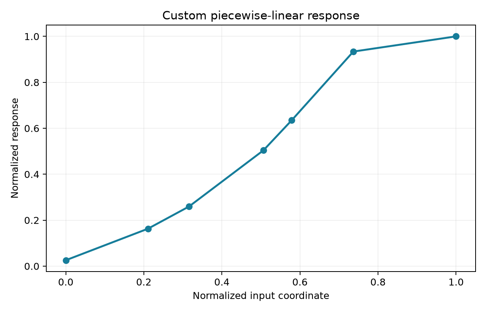

# Neural Networks with a Custom Nonlinear Activation

A software AI project covering synthetic classifiers, handwritten-digit recognition, image descriptors, transfer learning, fine-tuning, ensembles and grouped cross-validation. Its custom activation is specified entirely by normalized mathematical coordinates, with software ReLU and an affine-response control for comparison.

## Setup

Use Python 3.10 or newer. Run these commands from this directory:

```bash
python -m venv .venv
# Windows PowerShell:
.venv/Scripts/Activate.ps1
# Linux/macOS: source .venv/bin/activate
python -m pip install -r requirements.txt
```

NumPy handles numerical training and prediction. Pillow is needed for image descriptors and verification; Matplotlib is needed for plotting. ResNet18 and EfficientNet stages additionally need compatible PyTorch and torchvision installations.

```bash
python -m pip install Pillow matplotlib
# Optional deep-learning workflows:
python -m pip install torch torchvision
```

## Custom activation

Let `q = z²`, with `|z| <= 1`. A piecewise-linear function `g(q)` interpolates normalized knot/value pairs stored in `activations.py`. The hidden response is `h(z) = sqrt(g(z²))`. On a segment with slope `s`, its derivative is `s*z/h(z)`. At interior knots the right-hand segment is selected, and the last endpoint uses the last segment. Extrapolation is rejected. This custom function is distinct from mathematical ReLU.



`activation(z, 'custom')` returns values and derivatives. Controls include `relu`, `identity` and `matched_linear`; the latter replaces `g` with an affine function sharing its endpoint values. First-layer projection keeps inputs within the custom domain. The PyTorch head implements the same interpolation with automatic differentiation.

## Synthetic networks

```bash
python train_synthetic.py --epochs 2500 --activation custom --seeds 11 22 33
python train_synthetic.py --epochs 2500 --activation relu --seeds 11 22 33
```

Two Moons and noisy XOR use a 2–4–2 network, train-derived normalization, analytical gradients and Adam. Validation loss selects checkpoints. Bias is stored in an extra matrix column. Outputs are generated locally under ignored `runs/` directories.

## Handwritten digits

```bash
python train_digits.py --epochs 400 --seeds 11 22 33
python predict_digits.py my_8x8_images.csv
python train_mnist.py --epochs 80 --seeds 11
python predict_mnist.py my_28x28_images.npy
```

UCI 8×8 digits use a 64–32–10 network and the official train/test partitions, reserving validation from training. CSV prediction accepts rows of 64 pixel counts in 0–16. MNIST uses train-only 64-component PCA and a 64–128–10 network. Its inference accepts `.npy` images or CSV rows of 784 pixels in 0–255. The scripts download public benchmark datasets and compare custom, affine-response and ReLU activations. Prediction selects a custom model by validation loss.

## Histology image classification

These are software research examples for public images. Scores are uncalibrated and are not clinical diagnoses. Images, features, split manifests and trained models are generated locally and are not bundled.

```bash
python download_breast_data.py
python train_breast_histology.py --epochs 300 --seeds 11 22 33
python predict_breast_histology.py image.jpg
python improve_breast_histology.py
python predict_breast_improved.py image.jpg
```

The baseline extracts RGB thumbnails, gradient histograms, color statistics and binary texture descriptors. Scaling/PCA is fitted only on training cases. Case identifiers define disjoint groups. The improved variant uses frozen ResNet18 features and compares single-view with rotation-averaged representations.

Advanced stages require the preceding outputs:

```bash
python train_breast_strong.py
python select_breast_efficient.py
python finalize_breast_best.py
python train_breast_robust.py
python predict_breast_research.py image.jpg --variant balanced
```

The strong variant fine-tunes the last ResNet18 stage with a custom head. EfficientNet selection compares frozen-feature configurations. Final selection compares families and validation-selected ensembles. The robust variant performs grouped development cross-validation and threshold selection. `predict_breast_best.py`, `predict_breast_final.py` and `predict_breast_strong.py` load the corresponding generated model families. `predict_breast_research.py` exposes `balanced`, `efficient` and `group_cv` routes; these are software variant names rather than guaranteed rankings.

The benchmark was inspected during development. Repeating this workflow does not provide independent confirmation on a previously used test set; use a new held-out cohort for new claims.

## Standalone image training

`train_images.py` is an independent ResNet18 + ReLU example for user-provided `train/class_name/` and `validation/class_name/` folders:

```bash
python train_images.py data --epochs 10 --pretrained
```

## Supporting tools

```bash
python predict_synthetic.py runs/synthetic/moons_custom_11 --x 0.2 0.4
python summarize_results.py runs/digits/report.json
python export_model.py runs/digits/custom_11/model.npz exported_weights
python verify_ai.py
```

The summary tool creates a Markdown metrics table and can save a chart with `--plot chart.png`. The export tool writes locally trained NumPy matrices as CSV. Neither ships precomputed results.

| Group | Files |
| --- | --- |
| Core | `activations.py`, `train_synthetic.py`, `predict_synthetic.py` |
| Digits | `train_digits.py`, `train_mnist.py`, `predict_digits.py`, `predict_mnist.py` |
| Image data and features | `download_breast_data.py`, `train_breast_histology.py`, `improve_breast_histology.py` |
| Fine-tuning and selection | `train_breast_strong.py`, `select_breast_efficient.py`, `finalize_breast_best.py`, `train_breast_robust.py` |
| Image inference | `predict_breast_*.py`, `train_images.py` |
| Utilities | `summarize_results.py`, `export_model.py`, `verify_ai.py` |

Source code and a normalized activation definition are included. Pretrained project models, raw datasets, experiment outputs and manuscript artifacts are not bundled. Downloads and feature caches can be large. Check upstream dataset terms before reuse. NumPy gradients and short training paths were checked; full benchmark training and image-model searches were not rerun for this release.
